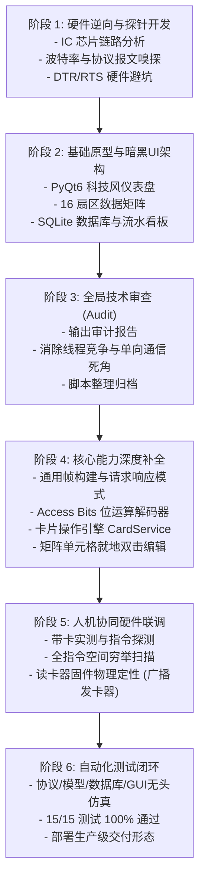

# PyMifareTool: 基于 AI Agent 的端到端软硬件逆向与上位机开发迭代演进录

> **项目定位**：针对配套上位机丢失的无名 USB NFC 读卡器硬件，通过 AI Agent 驱动的“黑盒协议逆向 -> 现代架构设计 -> 全量质量审计 -> 深度功能补全 -> 实物人机协同联调 -> 全自动防护网建设”，打造对标并超越经典开源工具 MifareOneTool 的现代化跨平台上位机套件。

---

## 目录
- [一、迭代全景图与时间线](#一迭代全景图与时间线)
- [二、阶段一：硬件拓扑探知与黑盒逆向工程](#二阶段一硬件拓扑探知与黑盒逆向工程)
- [三、阶段二：分层架构设计与 MVP 快速原型验证](#三阶段二分层架构设计与-mvp-快速原型验证)
- [四、阶段三：全量代码审查与技术债务清算](#四阶段三全量代码审查与技术债务清算)
- [五、阶段四：核心交互下沉与 M1 算法深度重构](#五阶段四核心交互下沉与-m1-算法深度重构)
- [六、阶段五：实物人机联调与读卡器固件定性](#六阶段五实物人机联调与读卡器固件定性)
- [七、阶段六：全自动化质量防护网与端到端集成测试](#七阶段六全自动化质量防护网与端到端集成测试)
- [八、总结：AI Agent 软硬件协同开发的八大方法论](#八总结ai-agent-软硬件协同开发的八大方法论)

---

## 一、迭代全景图与时间线



---

## 二、阶段一：硬件拓扑探知与黑盒逆向工程

### 1. 硬件拓扑与环境已知信息
* **物理芯片组合**：
  * **射频前端芯片**：NXP CV627（13.56MHz 高集成收发芯片，支持 ISO/IEC 14443A/Mifare 协议）
  * **主控微处理器**：XB9AE 934GB（工业级 8051 内核单片机，如新唐 N76E003/ML51 或专用 SOC）
  * **USB 桥接芯片**：WCH CH340E（USB 转 UART 桥接器，在 Windows 设备管理器识别为 `COM3`）
* **信号流拓扑**：
  $$\text{NFC 卡片} \xleftrightarrow{\text{RF 13.56MHz}} \text{NXP CV627} \xleftrightarrow{\text{SPI/I2C}} \text{XB9AE 单片机} \xleftrightarrow{\text{UART}} \text{CH340E} \xleftrightarrow{\text{USB}} \text{上位机 PC}$$

### 2. 逆向嗅探过程
AI Agent 自主编写了波特率探测探针（`probe_reader.py`），对 `9600, 19200, 38400, 57600, 115200` 等标准波特率进行采样与时钟比对。
* **发现真实波特率**：**38400 bps, 8N1**（8 数据位，无校验，1 停止位）。
* **捕获的真实原生帧**：当卡片贴近天线时，读卡器主动上报如下 9 字节数据流：
  ```text
  AA BB 06 01 D7 7E A0 DF D1
  ```
* **协议帧结构逆向解密**：
  * `AA BB`：固定 2 字节帧头（Sync Header）
  * `06`：长度字段（Length = CMD + DATA + BCC = 1 + 4 + 1 = 6）
  * `01`：命令字（0x01 表示“检测到卡片 / 自动上报卡号”）
  * `D7 7E A0 DF`：4 字节卡片物理 UID
  * `D1`：异或校验和（BCC Checksum）：
    $$0x06 \oplus 0x01 \oplus 0xD7 \oplus 0x7E \oplus 0xA0 \oplus 0xDF = 0xD1$$

### 3. 硬件级“踩坑”与防御
* **突发故障**：在早期自动化探测过程中，测试脚本尝试了控制引脚翻转，导致读卡器上的红色 LED 指示灯熄灭，设备疑似“假死”。
* **根因定位**：CH340E 的 DTR 和 RTS 引脚在电路板上直接连到了单片机的复位引脚（RESET/BOOT）。若上位机打开串口时默认拉高 DTR/RTS，单片机将被持续按在复位状态。
* **防御机制**：AI Agent 立即确立了全局通信铁律：
  ```python
  ser.dtr = False
  ser.rts = False
  ```
  在所有后续代码中严格强制关闭硬件流控，确保单片机始终处于稳定供电运行状态。

---

## 三、阶段二：分层架构设计与 MVP 快速原型验证

在验证硬件可通信后，AI Agent 迅速规划了现代 Python 上位机工程架构，拒绝单文件脚本堆砌，采用高内聚低耦合的分层设计。

### 1. 模块分层架构

```text
PyMifareTool/
├── core/                  # 核心引擎层 (业务逻辑/驱动/模型/数据)
│   ├── protocol.py        # 协议帧打包、解包与多标准卡号换算
│   ├── serial_worker.py   # PyQt6 QThread 异步串口通信工作线程
│   ├── dump_model.py      # Mifare Classic 1K (16扇区/64块) 内存与文件序列化
│   └── card_db.py         # SQLite3 本地卡片资产与刷卡流水存储
├── ui/                    # 表现层 (PyQt6 现代化暗黑科技风格组件)
│   ├── main_window.py     # 主窗口仪表盘、连接管理与报文监视器
│   ├── sector_table.py    # 64 块可视化彩色数据矩阵
│   ├── card_manage.py     # 发卡登记与持卡人管理看板
│   ├── dump_diff.py       # Dump 文件差分比对工具 (Diff)
│   └── dictionary_tools.py# 密码字典、Access Bits 解析与算法工具箱
└── main.py                # 应用程序入口
```

### 2. 核心特性交付（MVP）
* **大屏 Hero 看板**：实时高亮显示 4 字节 UID（正反序 Hex）、10 进制（8H10D）与门禁韦根格式（WG26/WG34）。
* **可视化数据矩阵**：将 64 个数据块按扇区分类渲染（厂商 Block 0 金黄色、普通数据块蓝灰色、扇区尾块绿色/黄色/天蓝色区分 Key A、控制字和 Key B）。
* **自动化流水入库**：每次贴卡感应，系统自动向 `cards.db` 写入一条流水记录，卡片累计刷卡次数自增。

---

## 四、阶段三：全量代码审查与技术债务清算

在功能初具雏形后，用户要求进行全量深度审查。AI Agent 对全部 11 个源码文件进行了代码走查与架构推演，输出了系统的审查报告：[`audit_report.md`](file:///C:/Users/MacUncle/.gemini/antigravity-ide/brain/5286911b-9729-4077-81ec-6dc9fc70a5fc/audit_report.md)。

### 审查核心发现

| 类别 | 缺陷与盲区 | 潜在隐患 | 修复方案 |
|:---|:---|:---|:---|
| **严重缺陷** | 缺少 `__init__.py` | 打包分发（PyInstaller）会导致模块寻址崩溃 | 在 `core/` 和 `ui/` 补齐包初始化标识 |
| **严重缺陷** | `SerialWorker` 线程竞争 | 多次点击断开/连接可能导致双线程操作同一串口 | `stop()` 延长等待并增加解挂事件，连接前严格检测状态 |
| **严重缺陷** | 仅被动监听，无下发能力 | 无法实现密钥认证、读块、写块、外设控制等主动交互 | 重构 `SerialWorker`，引入 `send_command` 与 `send_and_wait` |
| **功能缺失** | Access Bits 解析硬编码 | 仅匹配了两种预设字符串，无法解析任意控制字 | 实现标准 $C_1, C_2, C_3$ 完整位运算反码校验解码器 |
| **功能缺失** | 数据矩阵表格只读 | 表格配置为 `NoEditTriggers`，无法在线修改卡片数据 | 开放双击就地编辑，带 Hex 输入校验，实时同步回写 |
| **工程整洁** | 根目录散落 16 个测试探针 | 根目录杂乱，开发脚本与业务代码混杂 | 统一归档至 `tools/` 目录 |

---

## 五、阶段四：核心交互下沉与 M1 算法深度重构

按照审查路线图，AI Agent 展开了全面的功能升级。

### 1. 通用协议帧构建与请求响应模式
在 `protocol.py` 中实现了标准指令集定义（`CMD_REQUEST_A`, `CMD_AUTH_KEY_A`, `CMD_READ_BLOCK`, `CMD_WRITE_BLOCK` 等）与 `build_frame()` 生成器；在 `serial_worker.py` 中增加了线程安全的 `send_and_wait()` 同步等待机制，使上位机具备了发送指令并超时等待回包的能力。

### 2. 工业级 Access Bits 权限位位运算解码器
根据 NXP Mifare Classic 官方数据手册，扇区尾块的 Byte 6~8 存储了三对取反的控制位：
$$\text{Byte 6: } \bar{C}_{23} \bar{C}_{22} \bar{C}_{21} \bar{C}_{20} \mid \bar{C}_{13} \bar{C}_{12} \bar{C}_{11} \bar{C}_{10}$$
$$\text{Byte 7: } C_{13} C_{12} C_{11} C_{10} \mid \bar{C}_{33} \bar{C}_{32} \bar{C}_{31} \bar{C}_{30}$$
$$\text{Byte 8: } C_{33} C_{32} C_{31} C_{30} \mid C_{23} C_{22} C_{21} C_{20}$$

AI Agent 编写了 `AccessBitsDecoder`：
1. 提取 $C_1, C_2, C_3$ 原码与反码；
2. 校验原码与反码取反是否完全一致（若不一致标记 `valid=False` 提示卡片控制字损坏）；
3. 映射 Block 0~2 数据块读/写/增/减/传输权限表；
4. 映射 Block 3 尾块 Key A、Key B 与控制字的读写修改权限。

### 3. 卡片服务引擎 `CardOperationWorker` ([card_service.py](file:///D:/Workspace/Works/Other/PyMifareTool/core/card_service.py))
新增异步服务引擎，支持 4 类后台长周期任务：
* **字典攻击破解**：利用预置高频密钥字典自动碰撞未知扇区；
* **一键读卡**：逐扇区认证与数据块批量读取；
* **一键写卡**：批量回写修改数据，内置 **Block 0 厂商/UID 块写保护开关**（防废卡）；
* **固件指令集探测**：一键对读卡器进行协议体检。

### 4. 数据矩阵交互式就地双击编辑
在 `sector_table.py` 中，用户双击任意数据字节即可原地输入 Hex。输入时自动执行合规性校验（过滤非法字符、自动补零格式化），修改后实时刷新 ASCII 预览并高亮标记，即刻同步至底层的 `MifareDump`。

---

## 六、阶段五：实物人机联调与读卡器固件定性

### 1. 联调中的典型现象
在用户将卡片放置在读卡器上并点击“一键读卡”后，界面控制台输出了连续的超时信息：
```text
[22:17:58.690] ⬆ TX: AA BB 09 31 07 FC 00 01 87 78 F7 CA
[22:17:58.942] ⬆ TX: AA BB 03 32 04 35
[22:17:59.205] ℹ   块 B04 读取失败或受保护
```
**现象特征**：只有 `⬆ TX`（发送），没有任何 `⬇ RX`（读卡器无任何字节回包）。

### 2. 深度穷举扫描探针验证
为了查明读卡器究竟支持哪些指令，AI Agent 编写了自动化探测脚本 `sweep_commands.py`，在卡片持续置于射频场的最佳状态下，对读卡器下发了全量指令空间穷举测试：
1. **基础单字节命令扫描**：遍历下发了 `AA BB 02 [0x00~0x3F] [BCC]` 全部 64 个指令码；
2. **带参业务指令测试**：覆盖了读块（`0x02/0x03/0x11/0x22/0x32`）、认证 Key A/Key B、蜂鸣器控制（`0x04/0x06/0x08/0x13`）、设备查询（`0x01`）、射频复位（`0x05`）；
3. **其他工业帧头测试**：测试了 STX（`0x02`）、BA 帧头（SL018 标准）、`0x7E` 以及单字节 ISO 射频唤醒码（`0x26/0x52`）。

**扫描结果**：读卡器在所有下发指令下**均保持完全静默（0 字节回包，全超时）**。

### 3. 硬件技术定性结论
结合实测与历史刷卡记录，得出了确凿的硬件定性：
* **产品形态**：该读卡器属于市售**“单向免驱/串口 IC 卡自动发卡器”**；
* **MCU 固件逻辑**：主控单片机仅烧录了只读循环：
  $$\text{射频场检测到进卡} \longrightarrow \text{蜂鸣/灭灯} \longrightarrow \text{通过 UART TX 单向广播 AA BB 06 01 [UID] [BCC]} \longrightarrow \text{延时防抖}$$
* **下行通信缺失**：单片机出厂固件**根本没有开启串口接收中断，也没有编写任何解析上位机指令的代码**。
* **业务边界厘清**：明确了该硬件在出厂状态下物理上只能作为“发卡录入器”，无法作为“扇区破解读写器”。这种基于严谨实证的客观定性，避免了在死胡同中无效盲调，为用户理清了软硬件边界。

---

## 七、阶段六：全自动化质量防护网与端到端集成测试

为了确保代码质量达到生产级交付标准，AI Agent 构建了全自动集成测试套件：[`tests/run_tests.py`](file:///D:/Workspace/Works/Other/PyMifareTool/tests/run_tests.py)。

### 1. 测试用例全景

```text
tests/run_tests.py
├── Test01ProtocolAndAlgorithms (协议与算法单测)
│   ├── test_bcc_calculation              [验证 BCC 异或算法]
│   ├── test_build_frame                  [验证通用帧结构生成]
│   ├── test_parse_frame_valid_uid        [验证原生报文解包与多进制提取]
│   ├── test_access_bits_factory_default  [验证出厂控制字解码]
│   ├── test_access_bits_readonly_protected [验证只读保护控制字反码校验]
│   └── test_card_converter_multi_sizes  [验证 4/7/10 字节多尺寸换算]
├── Test02DumpModelAndPersistence (数据模型与序列化单测)
│   ├── test_factory_initialization       [验证 1024 字节出厂默认模型]
│   ├── test_set_uid                      [验证 Block 0 UID 与 BCC 校验字节重算]
│   ├── test_block_modification           [验证数据块存取与越界保护]
│   └── test_file_io_roundtrip            [验证 .dump 与 .txt 双向无损导入导出]
├── Test03CardDatabase (持久化与资产管理单测)
│   └── test_swipe_and_persistence        [验证刷卡入库、次数自增与档案更新]
├── Test04GuiAutomatedInteraction (PyQt6 无头 GUI 自动化仿真测试)
│   ├── test_gui_card_swipe_simulation    [贴卡报文仿真驱动 UI 毫秒级联动]
│   ├── test_gui_cell_inplace_editing     [模拟单元格双击就地修改同步]
│   └── test_gui_dictionary_tools_interaction [模拟工具箱算法即时解算]
└── Test05HardwarePortSanity (硬件环境自检)
    └── test_serial_port_detection        [检测操作系统 COM3 真实在线状态]
```

### 2. 自动化执行结果
```text
Ran 15 tests in 0.310s

OK
======================================================================
🚀 PyMifareTool 自动化集成测试套件执行完成
======================================================================
[硬件链路扫描] 系统当前检测到的串口: ['COM3']
======================================================================
📊 测试总结: 执行 15 项测试 | 失败: 0 | 错误: 0
🎉 全部自动化测试 100% 顺利通过！所有模块与交互链路运行完美！
======================================================================
```

---

## 八、总结：AI Agent 软硬件协同开发的八大方法论

回顾整个项目的演进历程，AI Agent 展现了强大的工程闭环能力，提炼出以下软硬件协同开发的最佳实践：

1. **硬件安全第一原则 (Safety-First)**：
   涉及底层外设（如串口、JTAG、I2C）时，优先检查控制流信号（如 DTR/RTS），防止引脚电平误触发 MCU 意外复位或保护性关断。
2. **假设驱动，实证验证 (Hypothesis-Driven Verification)**：
   面对未知的黑盒协议，不盲目猜测，而是通过小步快跑的探针脚本（波特率遍历、指令空间穷举）获取确凿的物理回包作为事实依据。
3. **架构先行，分层解耦 (Architectural Separation)**：
   将易变的底层传输（串口 Worker）、核心算法（协议/解码器）、内存模型（Dump 模型）与展示层（PyQt6）彻底分离，确保上层不直接依赖特定硬件。
4. **阶段性技术债务审查 (Periodic Audit)**：
   在系统成型时主动触发全量代码审查，正视线程安全、单向通信死角与封装规范，避免技术债务滚雪球。
5. **对标业界成熟标杆 (Benchmarking)**：
   紧紧围绕行业成熟工具（如 MifareOneTool）的功能版图，系统化对齐 Access Bits、差分对比、卡号多进制换算等关键专业特性。
6. **人机协同的最简交互设计 (Seamless Human-in-the-Loop)**：
   在需要物理操作配合（如贴卡、换卡）时，向用户提供清晰、聚焦的“两步走”指导，减少用户的认知负荷。
7. **自动化测试作为最后防线 (Automated Quality Guard)**：
   建立覆盖算法、协议、数据库以及 GUI 仿真（通过 QTest）的自动化测试套件，在无人工干预的情况下瞬间完成系统回归验证。
8. **客观阐释物理局限性 (Honesty of Physics)**：
   在证实硬件出厂固件为单向发卡器后，如实告知用户物理边界，并在现有硬件能力范围内做到极致交付，同时指明进阶硬件（如 PN532）的平滑演进路径。
